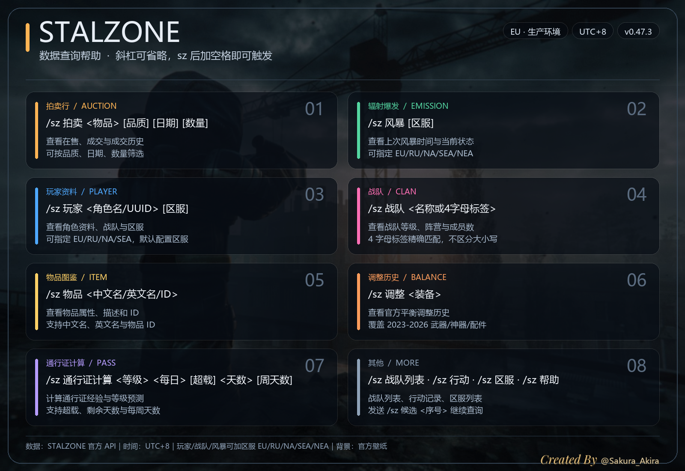
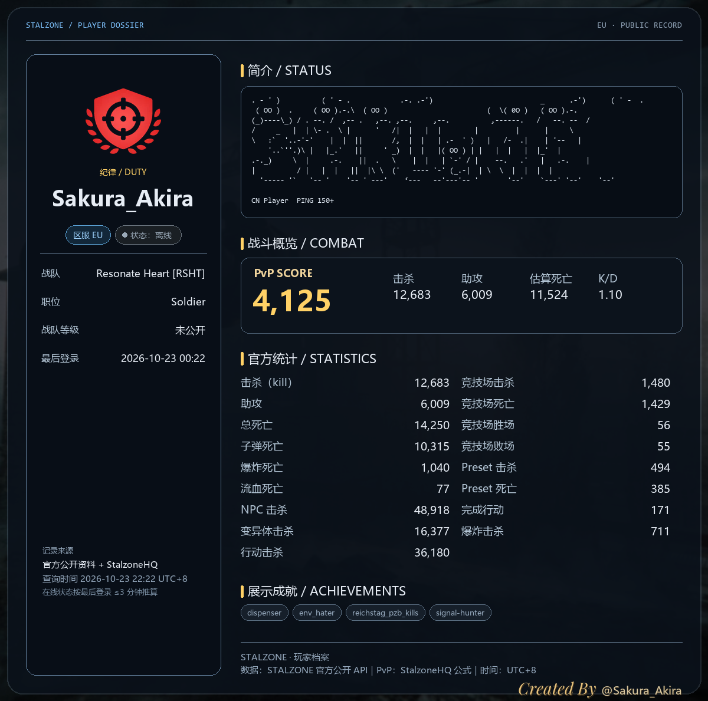
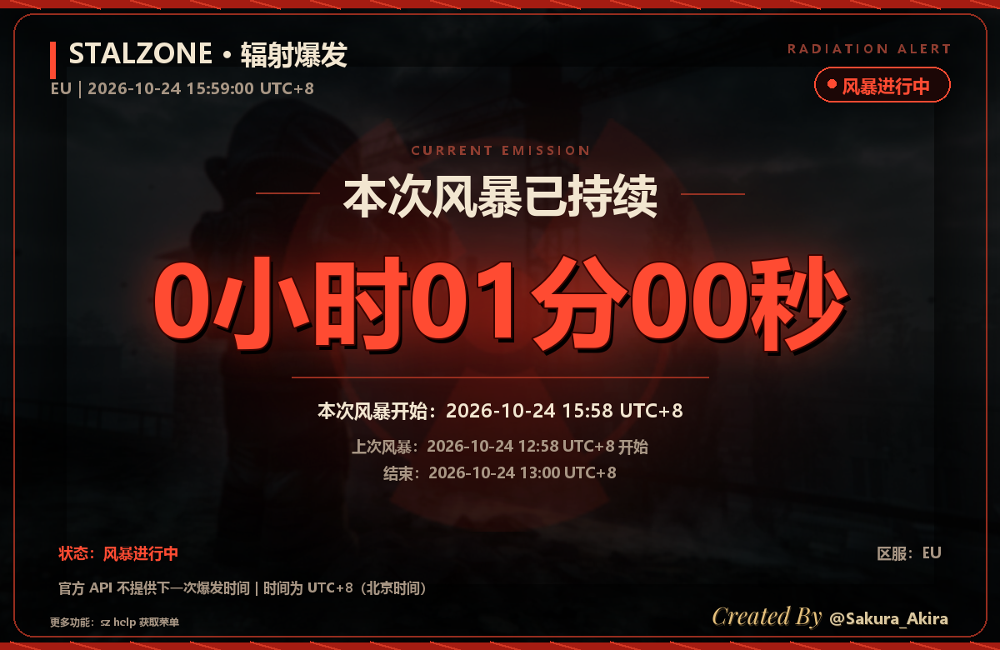
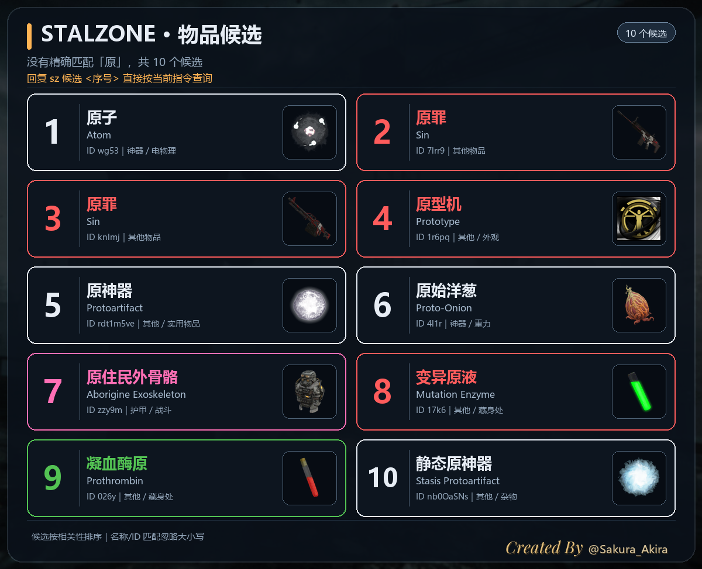
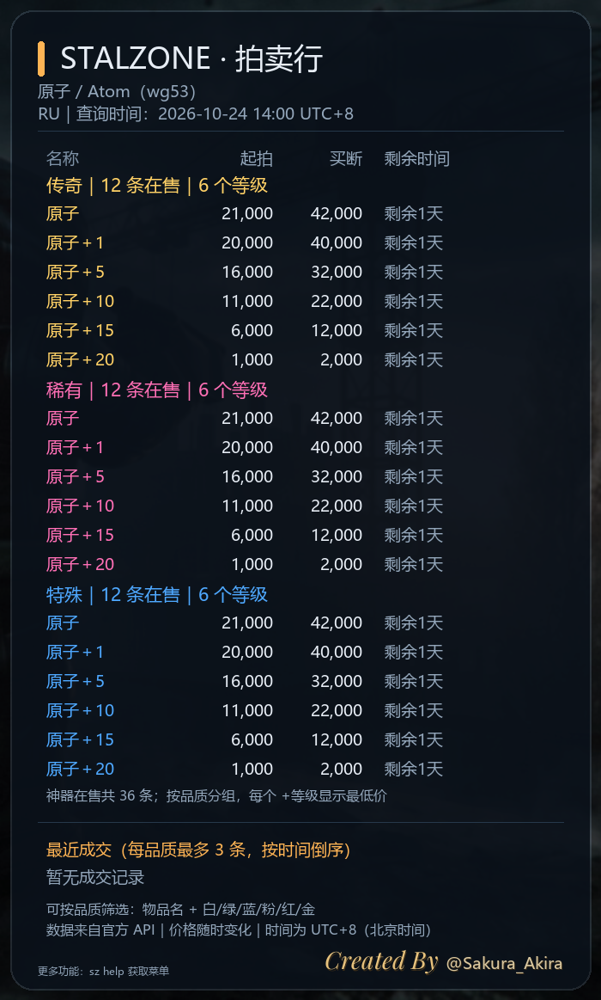
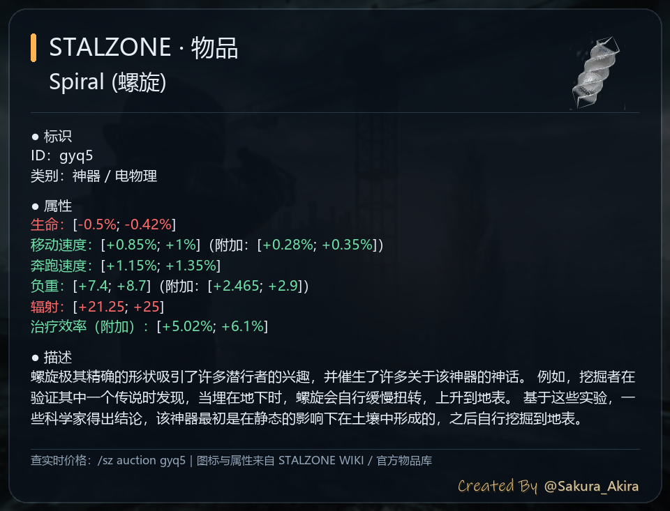
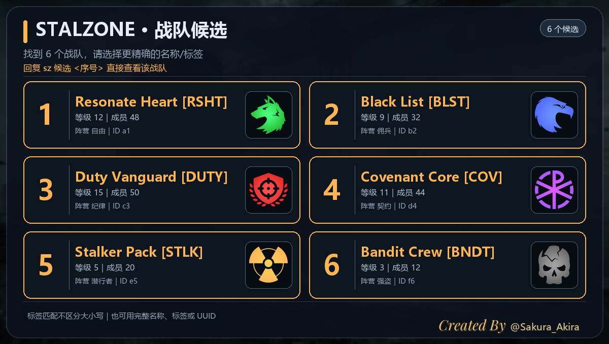

<div align="center">

# STALZONE 数据查询

**把 STALZONE 的实时数据查询搬进 QQ 群。**

拍卖 · 风暴 · 玩家 · 战队 · 物品 · 候选卡 · 通行证计算


[](https://github.com/sakura426649/astrbot_plugin_stalzone)
[](https://github.com/sakura426649/astrbot_plugin_stalzone/actions/workflows/tests.yml)


[English](README.en.md) · [GitHub](https://github.com/sakura426649/astrbot_plugin_stalzone)

<br>



</div>

面向 AstrBot 的 STALZONE 公开数据查询插件。发送一条 `/sz`，直接得到排版好的图片卡片：拍卖在售与成交、距上次风暴时间、玩家档案、战队资料、物品详情和候选列表。

实时数据全部来自官方 API；凭证只保存在 AstrBot 配置中，不写入代码、不提交仓库、不需要玩家账号或 OAuth 登录。

## 目录

- [界面预览](#界面预览)
- [功能亮点](#功能亮点)
- [快速开始](#快速开始)
- [常用指令](#常用指令)
- [输出与卡片](#输出与卡片)
- [配置](#配置)
- [部署](#部署)
- [数据与缓存](#数据与缓存)
- [项目结构](#项目结构)
- [开发与测试](#开发与测试)
- [常见问题](#常见问题)
- [数据来源与致谢](#数据来源与致谢)
- [Roadmap](#roadmap)
- [贡献](#贡献)

## 界面预览

| 玩家档案 | 辐射风暴 |
| :---: | :---: |
|  |  |
| **候选卡** | **拍卖行** |
|  |  |
| **物品详情** | **战队候选** |
|  |  |

> 图片在 QQ 缩略图和点开查看时颜色一致；所有卡片均为不透明 RGB PNG，不依赖外部图床。

## 功能亮点

| 模块 | 能力 |
| --- | --- |
| **拍卖行** | 当前在售、最近成交与按日期查询；神器按品质从高到低分组，非神器按 `物品×数量` 展示起拍、买断、单价和剩余时间，并标出最低单价 |
| **辐射风暴** | 以「距离上次风暴」为主视觉的大字计时卡，同时展示当前风暴状态、上次开始/结束时间 |
| **玩家档案** | 战术档案卡、阵营徽记、战队/职位、PvP 估算分和完整统计；名字下方显示在线/离线，API 无在线字段时按最后登录 ≤3 分钟推断 |
| **战队** | 按名称、标签或 UUID 查询；4 个英文字母的标签精确匹配，不区分大小写；支持战队列表 |
| **物品图鉴** | 2,615 件物品的中/英/俄/ID 索引，1,338 件详情与 2,600 个离线图标；属性按语义红绿着色 |
| **候选卡** | 模糊匹配最多展示前 20 个，两列卡片显示序号、品质色名称、ID/类别和物品图标；`sz 候选 <序号>` 直接重放原查询 |
| **平衡调整** | 合并 168 份 2023–2026 官方补丁公告，按物品列出全部改动，支持武器、神器与配件 |
| **通行证计算** | 本地计算每日/每周经验、超载与剩余天数；预测等级置顶大字展示，等级变化用颜色区分，不请求游戏 API |
| **查无结果** | 玩家/物品/拍卖/战队/调整未命中时发送提示图，重复查询名与区服，并给出修改建议 |

## 快速开始

1. 在 AstrBot WebUI 的插件页安装本插件：
   - 直接把仓库克隆到 `data/plugins/`；
   - 或下载仓库 ZIP，解压后将 `astrbot_plugin_stalzone/` 目录放到 `data/plugins/`（也可自行打包成插件 ZIP 后导入）。
2. 在 [STALZONE API 应用管理](https://eapi.stalzone.com/registration.html) 获取 `Client-Id` 与 `Client-Secret`。
3. 进入插件配置，填写凭证，并把 `region` 设为你的群所在区服（EU 群填 `eu`）。
4. 保存并重启/重载 AstrBot，在群里发送：

```text
/sz help
/sz 拍卖 原子
/sz 风暴 ru
/sz 玩家 Sakura_Akira eu
```

> [!IMPORTANT]
> **凭证安全**：`Client-Id` / `Client-Secret` 只填写在 AstrBot WebUI 配置中。不要发到群里、不要提交到 Git、不要写进截图。仓库和日志都不会保存 secret。
>
> **API 状态**：官方 API 仍处于 Beta，字段可能调整；插件对缺失字段做了容错，但生产环境需要已获批的应用凭证。

> [!TIP]
> `/sz` 的斜杠可以省略，但 `sz` 后必须加一个空格才会触发：`sz 拍卖 原子` 等价于 `/sz 拍卖 原子`。单独发 `sz` 不会触发。

## 常用指令

| 指令 | 作用 | 示例 |
| --- | --- | --- |
| `/sz auction <物品> [品质] [日期] [数量]` | 在售 + 成交；支持品质、日期和数量筛选 | `/sz 拍卖 原子 粉 6.11 20` |
| `/sz emission [区服]` | 距上次风暴时间与当前状态 | `/sz 风暴 ru` |
| `/sz player <角色名/UUID> [区服]` | 玩家公开资料、战队、PvP 估算分 | `/sz 玩家 Sakura_Akira eu` |
| `/sz item <中文名/英文名/ID>` | 物品属性、描述、类别和图标 | `/sz 物品 寒冰` |
| `/sz 候选 <序号>` | 使用最近一次候选继续原查询 | `/sz 候选 1` |
| `/sz 调整 <装备>` | 官方平衡调整历史 | `/sz 调整 螺旋` |
| `/sz 通行证计算 <等级> <每日任务> [天数]` | 通行证经验与等级预测 | `/sz 通行证计算 15 15+2 20` |
| `/sz clan <名称/标签/UUID>` | 战队资料；4 字母标签精确匹配 | `/sz 战队 RSHT` |
| `/sz clans [页码]` | 战队列表 | `/sz 战队列表 2` |
| `/sz operations [地图ID]` | 最近行动记录 | `/sz 行动 operation_bigcleanup` |
| `/sz regions` | 官方区服列表 | `/sz 区服` |
| `/sz diag` / `/sz 状态` | 运行环境、API、数据资产、缓存、存储和渲染状态（不含凭证） | `/sz 状态` |
| `/sz help` | 图片帮助菜单 | `/sz help` |

常用中文别名：`拍卖行`、`风暴`/`爆发`、`玩家`/`角色`、`物品`、`战队`、`行动`、`区服`。风暴查询还支持简写 `fb`。

**日期与区服**

- 日期支持 `6.11`、`6/11`（当前年份）和 `25.6.11`、`25/6/11`；按 UTC+8 自然日计算。
- 区服参数支持 `EU`、`RU`、`NA`、`SEA`、`NEA`，不区分大小写；省略时使用插件配置的默认区服。玩家、战队和风暴命令会把末尾完整的区服缩写识别为区服参数，名字中间的空格会保留。
- 所有展示时间统一为 **UTC+8（北京时间）**。
- 物品名/ID 匹配忽略大小写，`ak-308`、`AK-308` 都能解析到同一物品。

## 输出与卡片

`render_mode` 控制输出方式：

| 模式 | 行为 |
| --- | --- |
| `auto`（默认） | 有 Pillow + 中文字体时发图片；否则自动回退文本卡片 |
| `text` | 始终发送卡片式纯文本，适合低配容器 |
| `image` | 强制图片；渲染失败时仍会回退文本，不影响指令可用性 |

图片卡片包括：帮助菜单、拍卖行、玩家档案、辐射风暴、物品详情、候选列表、战队资料和通行证预测。卡片使用官方壁纸暗色背景、品质色与语义色，署名位于右下角。

候选列表为两列卡片，每行最多两个物品；行数按候选数量增长，最多展示最接近的前 20 个。物品图标优先使用离线图标；2,600 件已随包分发，缺失时再批量从 CDN 补齐并缓存，源站没有图片的条目显示「暂无图标」而不是问号。

## 配置

在 AstrBot WebUI → 插件 → `STALZONE 数据查询` 中配置：

| 配置项 | 默认 | 说明 |
| --- | --- | --- |
| `client_id` | 空 | STALZONE API 应用 Client-Id |
| `client_secret` | 空 | STALZONE API 应用 Client-Secret；UI 会掩码 |
| `region` | `ru` | `ru` / `eu` / `na` / `sea` / `nea`；EU 群建议 `eu` |
| `api_base` | 生产 | 默认 `https://eapi.stalzone.com`；可切 `https://dapi.stalzone.com` 演示环境 |
| `render_mode` | `auto` | `auto` / `text` / `image` |
| `font_path` | 空 | Linux 中文字体路径；留空自动查找 Noto CJK / 文泉驿 / 微软雅黑 |
| `lunar_enrich` | `true` | 玩家资料追加 Lunar 第三方 K/D、KDA、战斗分；关闭后不请求第三方 |
| `sc_core_fallback` | `true` | 官方成交历史翻页失效时用 SC CORE 第三方存档补全旧成交；结果会标注来源 |
| `command_cooldown` | `1.0` | 同一群两次查询的最小间隔（秒）；`0` 为关闭 |

### 自定义物品别名（无需重建索引）

在 AstrBot 插件数据目录（通常是 `data/plugin_data/astrbot_plugin_stalzone/`）新建 `item_aliases.json`：

```json
{
  "wg53": ["核弹", "Atom", "原子弹"],
  "vjr1n": ["AK74", "AK-74"]
}
```

键是物品 ID（用 `/sz 物品 原子` 可看到），值是别名数组。别名不区分大小写，空格和连字符会归一化；保存后在 WebUI 重载插件即可生效。别名只在本机生效，不会修改或重写 `item_index.json`。可参考 [`docs/item_aliases.example.json`](docs/item_aliases.example.json)。

平衡公告、新物品/神器和新图标的维护流程见 [`docs/maintenance.md`](docs/maintenance.md)。

**认证方式**：使用 `Client-Id` + `Client-Secret` 请求头，不需要 OAuth 用户授权。角色列表、好友列表、战队成员列表属于 UserAuth 端点，本插件不提供。

> [!WARNING]
> 如果使用演示环境 `dapi.stalzone.com`，角色资料和行动记录可能没有数据；这是演示数据不完整，不是插件解析失败。正式使用请切换到生产环境并填写已获批凭证。

## 部署

### 安装插件

```bash
# 在 AstrBot 的 data/plugins 目录下
git clone git@github.com:sakura426649/astrbot_plugin_stalzone.git
cd astrbot_plugin_stalzone
pip install -r requirements.txt
```

Linux 容器如果缺少中文字体，安装 Noto CJK：

```bash
apt-get update && apt-get install -y fonts-noto-cjk
```

然后在 AstrBot WebUI 重载插件，填写配置。首次发 `/sz help` 会生成帮助图并缓存。

### Docker

假设容器名为 `astrbot`，数据目录挂载到 `/AstrBot/data`：

```bash
docker cp astrbot_plugin_stalzone astrbot:/AstrBot/data/plugins/
docker exec -it astrbot pip install -r /AstrBot/data/plugins/astrbot_plugin_stalzone/requirements.txt
docker restart astrbot
```

如果 WebUI 已显示插件但启动报 `ModuleNotFoundError: httpx`，按上面的 `docker exec` 命令在容器内手动安装依赖。

### 国内网络

如果 pip 指向阿里云内网镜像导致找不到新版 `httpx`，改用公网镜像：

```bash
pip install -r requirements.txt -i https://mirrors.aliyun.com/pypi/simple/
# 或
pip install -r requirements.txt -i https://pypi.tuna.tsinghua.edu.cn/simple
```

## 数据与缓存

- **实时数据**：拍卖、风暴、玩家、战队、行动记录、区服全部来自官方 API，不写入知识库。
- **静态数据**：物品索引、物品详情、图标和 2023–2026 平衡公告随插件打包，离线可查。
- **第三方数据**：Lunar 只用于玩家资料的 K/D/KDA 补充；SC CORE 只用于官方历史翻页失效时的旧成交补全；两者都会在输出中标注来源。
- **性能**：物品搜索使用别名缓存和模糊匹配预筛；搜索、图片渲染和 base64 编码在线程池执行；官方 API 复用同一个 `httpx.AsyncClient` 连接池。
- **API 缓存、重试与并发**：普通拍卖在售/成交缓存 20 秒，风暴状态缓存 10 秒；429/5xx/超时最多重试 2 次并指数退避；同一时刻最多 6 个查询进入 API 处理；同一群默认 1 秒查询冷却。带日期的历史查询不缓存，保证翻页结果准确。
- **缓存上限**：候选按群/会话保存 10 分钟，最多 200 个会话；SC CORE 物品键最多 4096 条；物品图标超过 30 天清理；临时卡片图超过 24 小时清理；帮助图只保留当前版本/区服/环境的一份。

> 实时价格和排行榜会随时变化，历史查询结果可能受官方 API 可查范围限制；以游戏内实际数据为准。

## 项目结构

```text
astrbot_plugin_stalzone/
├── main.py                  # AstrBot 入口：指令解析、API 编排、回复发送
├── api_client.py            # httpx.AsyncClient 封装、认证、超时与错误分类
├── formatters.py            # 文本与共享视图模型
├── image_renderer.py        # Pillow 卡片渲染
├── command_parser.py        # /sz 指令与别名解析
├── item_index.py            # 中/英/俄物品名 → item_id
├── item_index.json          # 2,615 件物品双语索引
├── item_details.json        # 1,338 件物品属性/描述
├── item_icons/              # 2,600 个离线图标
├── balance_history.py       # 官方平衡公告索引
├── season_pass.py           # 通行证计算
├── pda_format.py            # PDA §颜色/渐变解析
├── lunar_client.py          # Lunar 第三方战报（可选）
├── sc_core_client.py        # SC CORE 第三方历史补全（可选）
├── assets/                  # 壁纸、署名字体、阵营徽记
├── docs/images/             # README 预览图
├── tests/                   # 单元测试与集成测试
├── _conf_schema.json
├── metadata.yaml
└── requirements.txt
```

## 开发与测试

测试不需要真实 API 凭证，使用 mock HTTP 与 AstrBot stub：

```bash
python -m unittest discover -s tests -v
```

当前测试覆盖 API 客户端、格式化、物品索引、PDA 富文本、图片渲染、候选卡、区服参数、缓存与主流程，共 **140 个测试**；GitHub Actions 在 Windows / Linux、Python 3.10 / 3.12 上自动跑测试，并执行覆盖率门槛（当前 76%，门槛 75%）。

演示服冒烟测试（需要演示应用凭证）：

```powershell
$env:SZ_CID="你的演示 Client-Id"
$env:SZ_SECRET="你的演示 Client-Secret"
python tests/demo_smoke.py
```

开发约定：

- 只使用 `httpx` / `aiohttp` 等异步 HTTP 客户端，不使用 `requests`。
- 图片渲染、搜索和编码等 CPU 操作放入线程池，避免阻塞 AstrBot 事件循环。
- 凭证只从配置读取，不写死、不打印、不提交。
- 修改图片布局后请同时更新 `docs/images/` 中的预览图与测试。

默认分支为 **master**，Pull Request 也请提交到 `master`。

## 常见问题

| 现象 | 排查 |
| --- | --- |
| 提示“未配置 Client-Id / Client-Secret” | WebUI 插件配置未填，或保存后未重载插件 |
| 401 / 403 | 应用未获批、凭证错误，或用演示凭证访问生产 |
| 演示有数据、生产为空 | 检查 `region`；再确认物品/角色是否属于该区服 |
| 400 | 物品 ID 无效、物品不可交易、角色名格式不对 |
| 404 | 角色名/物品 ID 不存在；演示服部分资料本身没有数据 |
| 429 | 官方 API 频率限制；稍后重试，不要连续刷 |
| 图片没有发送 | 确认 Pillow 已安装、存在中文字体；可先设 `render_mode=text` 验证 |
| Linux 中文变方框 | 安装 `fonts-noto-cjk`，或在 `font_path` 指定字体文件 |
| `sz ...` 不触发 | `sz` 后必须有空格；也可以直接用 `/sz ...` |
| HQ PvP 分对不上 | HQ 页面显示的是其自身缓存分；插件只按实时官方统计计算并标注公式 |
| 历史成交查不到 | 官方只保留有限历史；插件会标注 SC CORE 存档起点，不能保证更早数据 |

## 数据来源与致谢

| 来源 | 用途 |
| --- | --- |
| [STALZONE 官方 API](https://eapi.stalzone.com/reference) | 拍卖、风暴、玩家、战队、行动记录、区服 |
| [STALZONE WIKI](https://stalzone.wiki/) | 物品英文名称、属性、图标 |
| 社区汉化 `zh.lang` | 物品中文名（玩家社区维护，非官方；官方不支持中文） |
| [StalzoneHQ](https://stalzonehq.com/) | 阵营图标与开放世界 PvP 公式参考 |
| [Lunar Zone](https://lunar-zone.com/) | 可选的第三方战队战报 K/D/KDA |
| [SC CORE](https://sccore.ru/) | 可选的第三方成交历史补全 |
| [AstrBot](https://github.com/AstrBotDevs/AstrBot) | 插件运行框架 |

物品中文名来自玩家社区维护的 `zh.lang` 汉化文件（**非官方**；游戏官方不支持中文，翻译可能滞后于新物品）；英文名与物品属性来自 STALZONE WIKI。平衡历史来自官方 Steam 公告。Playfair Display Italic 字体按 SIL Open Font License 1.1 随包分发，许可证见 `assets/PlayfairDisplay-OFL.txt`。

> 本项目是非官方工具，与 EXBO / STALZONE 没有隶属关系。游戏名称、图标和数据的版权归各自权利人所有；第三方数据仅作补充并在输出中标注。

## Roadmap

| 方向 | 说明 | 状态 |
| --- | --- | --- |
| 拍卖短 TTL 缓存 | 降低重复查询的 API 压力与 429 风险 | 计划中 |
| 更多卡片主题 | 为不同群提供可切换的视觉样式 | 计划中 |
| 配装分享/导入 | 把候选与物品组合成可分享的配装卡 | 讨论中 |
| 可观测性 | 更细的请求耗时、缓存命中和失败日志 | 持续 |

## 贡献

欢迎提交 Issue 和 Pull Request。

- **Bug**：附上插件版本、AstrBot 版本、区服、复现指令和脱敏日志。
- **功能建议**：说明使用场景、期望输出和与现有指令的关系。
- **PR**：目标分支为 `master`；提交前运行 `python -m unittest discover -s tests`，并同步更新 README / 预览图。
- **安全**：不要在 Issue、PR、截图或日志中暴露 `Client-Id` / `Client-Secret`。

如果这个插件对你有帮助，欢迎点一个 Star。
